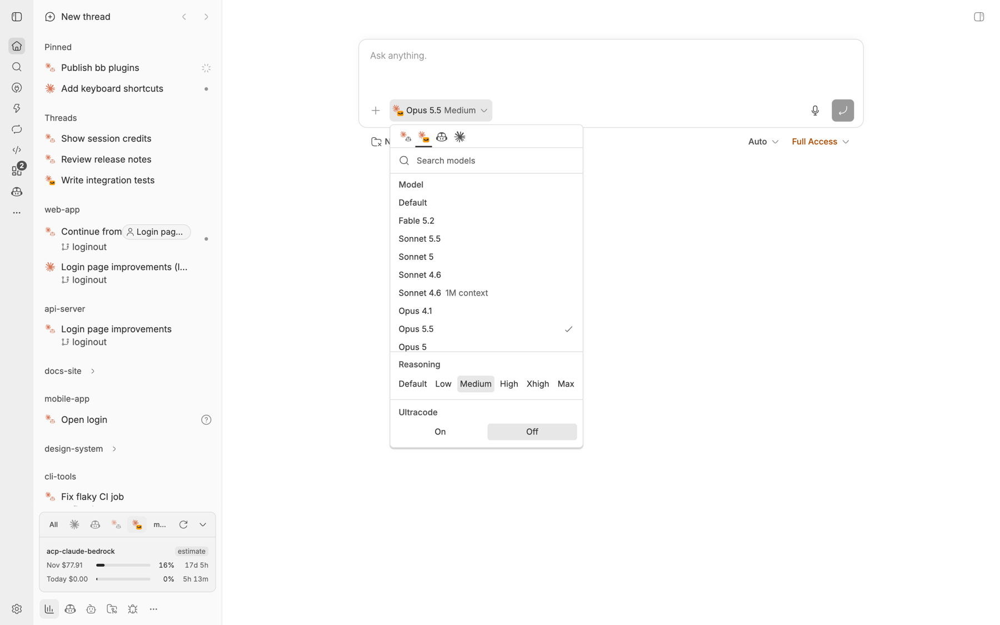

# bb-plugin-acp-claude-bedrock

Claude Code on **AWS Bedrock** as an ACP agent in [bb](https://getbb.app), shown
as **Claude Code (Bedrock ACP)** in the provider picker. It has these parts:

- `bin/claude-bedrock-acp`: the launcher script. It runs Claude Code in Bedrock
  mode over ACP, using
  [`@agentclientprotocol/claude-agent-acp`](https://www.npmjs.com/package/@agentclientprotocol/claude-agent-acp).
- `bin/claude-bedrock-acp-proxy.mjs`: a small ACP proxy started by the
  launcher. It applies the price factor to the cost bb shows, hides the
  subagent picker option and records spend in a local ledger.
- The bb plugin. It registers the launcher as the custom agent `claude-bedrock`
  (provider `acp-claude-bedrock`) in bb's ACP agents plugin and keeps that entry
  up to date, passes the plugin settings to the agent, gives the provider the
  Claude mark with an AWS badge as its icon, and adds an estimated-spend entry
  to bb's Provider usage panel. It uses only the public plugin SDK.

## Screenshots

**Claude Code (Bedrock ACP)** in the model picker, with its estimated spend in the
Provider usage panel (bottom left):



The plugin settings: API key, region, adapter, budget and price factor.


## Requirements

- bb 0.49 or later, with the built-in ACP agents plugin (`provider-acp`).
- Node.js and [Claude Code](https://claude.com/claude-code) (`claude` on PATH).
  Without `claude`, the ACP adapter uses its bundled Claude Code.
- Bedrock access to the Anthropic models, and either a
  [Bedrock API key](https://docs.aws.amazon.com/bedrock/latest/userguide/api-keys.html)
  or AWS credentials that Claude Code can use (see
  [Claude Code on Amazon Bedrock](https://docs.claude.com/en/docs/claude-code/amazon-bedrock)).

## Setup

1. Install the plugin. From a clone:

   ```sh
   git clone https://github.com/alexkli/bb-plugin-acp-claude-bedrock.git
   cd bb-plugin-acp-claude-bedrock
   npm install
   bb plugin build
   bb plugin install .
   ```

   On load, the plugin adds **Claude Code (Bedrock ACP)** to bb's ACP agents.
   It updates that entry on every load, so a plugin update that moves the
   launcher needs no action. Other custom agents are left alone.

2. Open Settings → Plugins → **Claude Bedrock ACP provider** and set:
   - **Bedrock API key**. bb stores it as a secret setting. The plugin writes
     it to a file only your user can read
     (`~/.bb/plugins/acp-claude-bedrock/host-data/bedrock-api-key`) and gives
     the agent only that file's path, so the key never appears in the ACP
     agents config. Without a key, the launcher uses the macOS keychain item
     `claude-bedrock-token` if present
     (`security add-generic-password -a "$USER" -s claude-bedrock-token -w`),
     else the normal AWS credential chain. Set **AWS profile** for the latter.
   - **AWS region**, default `us-east-1`.

3. Optional: install the ACP adapter once. Without it, the launcher runs it
   through `npx`, which is slower to start:

   ```sh
   npm install -g @agentclientprotocol/claude-agent-acp
   ```

   Or point **ACP adapter command** at a pinned install, e.g.
   `node /path/to/node_modules/@agentclientprotocol/claude-agent-acp/dist/index.js`.

4. Pick **Claude Code (Bedrock ACP)** in a new thread.

### Settings and launcher variables

The plugin passes its settings to the agent as environment variables in the
agent entry. You can add more variables to the entry's `env` in the ACP agents
settings; the plugin keeps them.

| Setting | Variable | Default |
| --- | --- | --- |
| AWS region | `AWS_REGION` | `us-east-1` |
| AWS profile | `AWS_PROFILE` | unset |
| ACP adapter command | `CLAUDE_AGENT_ACP` | `claude-agent-acp` on PATH, else `npx` |
| Price factor | `CLAUDE_BEDROCK_PRICE_FACTOR` | `1` |
| Bedrock API key | `CLAUDE_BEDROCK_KEY_FILE` (path to the key file) | unset |

Launcher-only variables: `CLAUDE_CODE_EXECUTABLE` (default `claude` on PATH),
`CLAUDE_BEDROCK_KEYCHAIN_SERVICE` (default `claude-bedrock-token`) and
`CLAUDE_BEDROCK_ACP_HIDE_OPTIONS` (default `agent`, comma-separated ACP config
options to hide). Other Claude Code variables, such as `ANTHROPIC_MODEL`, pass
through as well. Each launch appends one line (time, region, credential source,
adapter; never the key) to `~/.local/state/claude-bedrock/launcher.log`.

## Usage entry

The plugin adds estimated spend for `acp-claude-bedrock` to bb's Provider usage
panel and footer: this month and today, measured against a monthly budget.
Today's budget is the monthly budget divided by the days in the month. There
are two plugin settings for it:

- **Monthly budget (USD)**, default 100.
- **Price factor**, default 1 (list price). If you have a negotiated Bedrock
  discount or markup, set it here, e.g. 0.8 for 20% below list. It also
  applies to the cost bb shows in each thread.

The data comes from a local ledger,
`${XDG_STATE_HOME:-~/.local/state}/claude-bedrock/cost.jsonl`, of Claude Code's
own running list-price cost estimates. The proxy appends one line whenever a
bb thread's cost changes. Other tools can append terminal sessions in the same
format: `{"t": <epoch ms>, "src": "cli", "key": "<unique session id>", "usd": <running list-price USD>}`.
Only spend recorded in the ledger is counted. This is an estimate, not your
AWS bill.

bb lists the entry under the raw provider id, because ACP custom agents don't
have the usage capability. Setting `"providerUsage": true` on the custom agent
fixes the name, but then bb's ACP plugin also adds an empty "Usage
unavailable" card for it.

## Development

`bb plugin build` compiles the plugin into `dist/`, and
`bb plugin reload acp-claude-bedrock` reloads it. `npx tsc -p .` type-checks it.

## License

MIT
