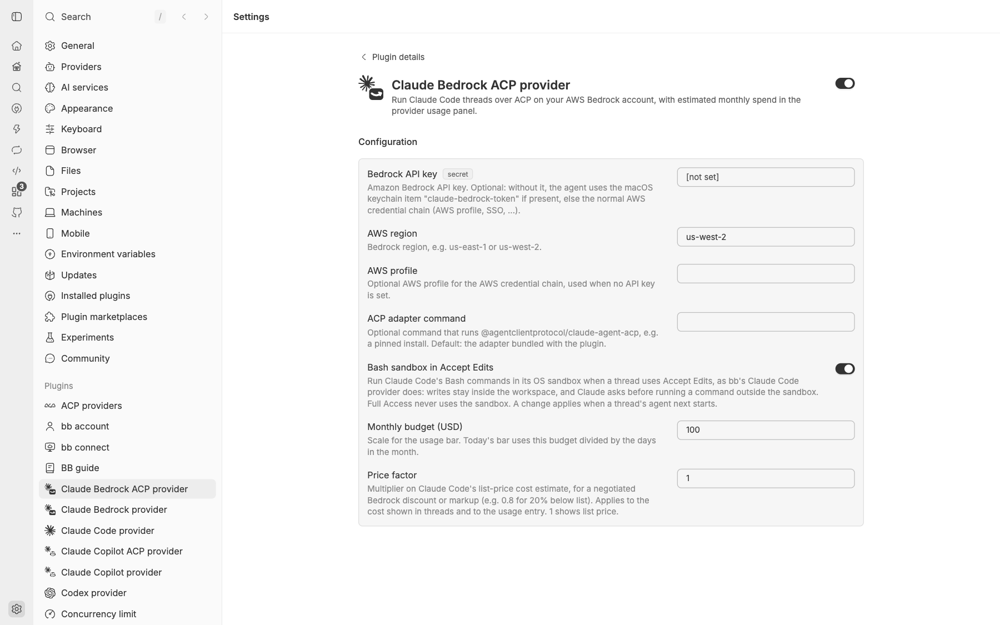

# bb-plugin-acp-claude-bedrock

Claude Code on **AWS Bedrock** as an ACP agent in [bb](https://getbb.app), shown
as **Claude Code (Bedrock ACP)** in the provider picker. It has these parts:

- `bin/claude-bedrock-acp`: the launcher script. It runs Claude Code in Bedrock
  mode over ACP, using
  [`@agentclientprotocol/claude-agent-acp`](https://www.npmjs.com/package/@agentclientprotocol/claude-agent-acp).
- `bin/claude-bedrock-acp-proxy.mjs`: a small ACP proxy started by the
  launcher. It runs Bash in Claude Code's sandbox in Accept Edits (see
  [Permission modes and the sandbox](#permission-modes-and-the-sandbox)),
  applies the price factor to the cost bb shows, hides the subagent picker
  option, records spend in a local ledger, and makes plan mode ask before it
  implements (see [Plan mode](#plan-mode)).
- The bb plugin. It registers the provider `acp-claude-bedrock` itself, which
  bb runs through the plugin SDK's ACP bridge, with bb's permission modes,
  `/compact`, forks and side chats. It passes the plugin settings to the
  agent, gives the provider the Claude mark with an AWS badge as its icon
  (monochrome, to tell it apart from the colored icon of the Claude Bedrock
  provider plugin), and adds an estimated-spend entry to bb's Provider usage
  panel. It uses only the public plugin SDK.

## Screenshots

**Claude Code (Bedrock ACP)** in the model picker, with its estimated spend in the
Provider usage panel (bottom left):


The plugin settings: API key, region, profile, adapter, Bash sandbox, budget and price factor.



## Requirements

- bb 0.49 or later.
- Node.js and [Claude Code](https://claude.com/claude-code) (`claude` on PATH).
  Without `claude`, the ACP adapter uses its bundled Claude Code.
- Bedrock access to the Anthropic models, and either a
  [Bedrock API key](https://docs.aws.amazon.com/bedrock/latest/userguide/api-keys.html)
  or AWS credentials that Claude Code can use (see
  [Claude Code on Amazon Bedrock](https://docs.claude.com/en/docs/claude-code/amazon-bedrock)).

## Setup

1. Install the plugin. From a clone:

   ```sh
   git clone https://github.com/alexkli/bb-plugin-acp-claude-bedrock.git
   cd bb-plugin-acp-claude-bedrock
   npm install
   bb plugin build
   bb plugin install .
   ```

   On load, the plugin registers the provider **Claude Code (Bedrock ACP)**.
   If that fails, bb shows the plugin as needing configuration, with the
   reason. Check the setup with `bb acp-claude-bedrock status`.

   Updating from 0.1.x: see [Updating from 0.1](#updating-from-01).

2. Open Settings → Plugins → **Claude Bedrock ACP provider** and set:
   - **Bedrock API key**. bb stores it as a secret setting. The plugin writes
     it to a file only your user can read
     (`~/.bb/plugins/acp-claude-bedrock/host-data/bedrock-api-key`) and gives
     the agent only that file's path, so the key never appears in the agent's
     environment or settings file. Without a key, the launcher uses the macOS keychain item
     `claude-bedrock-token` if present
     (`security add-generic-password -a "$USER" -s claude-bedrock-token -w`),
     else the normal AWS credential chain. Set **AWS profile** for the latter.
   - **AWS region**, default `us-east-1`.

3. The ACP adapter ships with the plugin as a dependency, pinned to an exact
   version (`@agentclientprotocol/claude-agent-acp`, installed by
   `npm install`), so there is nothing to install. To use a different one, point **ACP adapter
   command** at it, e.g.
   `node /path/to/node_modules/@agentclientprotocol/claude-agent-acp/dist/index.js`.

4. Pick **Claude Code (Bedrock ACP)** in a new thread.

### Settings and launcher variables

The plugin writes its settings as environment variables to a file only your
user can read (`~/.bb/plugins/acp-claude-bedrock/host-data/agent.env`), which
the launcher reads on every start. A change applies when a thread's agent
next starts. To pass other variables to the agent, add them to **Extra
environment variables** as `NAME=value` pairs separated by spaces, e.g.
`CLAUDE_BEDROCK_ASK_PLAN_APPROVAL=0`; the settings in the table win over them.

| Setting | Variable | Default |
| --- | --- | --- |
| AWS region | `AWS_REGION` | `us-east-1` |
| AWS profile | `AWS_PROFILE` | unset |
| ACP adapter command | `CLAUDE_AGENT_ACP` | the plugin's bundled adapter, else `claude-agent-acp` on PATH, else `npx` |
| Price factor | `CLAUDE_BEDROCK_PRICE_FACTOR` | `1` |
| Bedrock API key | `CLAUDE_BEDROCK_KEY_FILE` (path to the key file) | unset |
| Bash sandbox in Accept Edits | `CLAUDE_BEDROCK_SANDBOX` (`0` turns it off) | on (unset) |

Launcher-only variables: `CLAUDE_CODE_EXECUTABLE` (default `claude` on PATH),
`CLAUDE_BEDROCK_KEYCHAIN_SERVICE` (default `claude-bedrock-token`) and
`CLAUDE_BEDROCK_ACP_HIDE_OPTIONS` (default `agent`, comma-separated ACP config
options to hide). Other Claude Code variables, such as `ANTHROPIC_MODEL`, pass
through as well. Each launch appends one line (time, region, credential source,
adapter; never the key) to `~/.local/state/claude-bedrock/launcher.log`.

## Permission modes and the sandbox

bb offers ACP agents two permission modes, **Accept Edits** and **Full
Access**. The plugin declares both for its provider (`permissionCli`): bb
starts the launcher with `--bb-permission-mode=accept-edits` or
`--bb-permission-mode=full`, and restarts the agent with the new value when a
thread's mode changes. The proxy takes that argument off the adapter's command
line.

In **Accept Edits** the proxy runs Claude Code's Bash commands in its OS
sandbox, with the same settings bb's own Claude Code provider uses: writes stay
inside the workspace and the thread's extra folders (such as its storage
folder), sandboxed commands run without a prompt, local servers can listen, and
Claude asks before it runs a command outside the sandbox. bb shows that request
as an approval. Claude may still edit files inside the workspace from Bash (bb
shows no diff for those); when Bash can't write somewhere, it switches to its
Edit and Write tools, which bb shows as file changes with diffs. In **Full
Access** there is no sandbox, as in bb's Claude Code provider.

Turn the sandbox off with the **Bash sandbox in Accept Edits** setting. A
change applies when a thread's agent next starts. The proxy adds the sandbox
to `_meta.claudeCode.options` of every session start; a sandbox the client
sets itself wins. Claude Code's own permission mode (Auto, Default, ...) is a
separate session option of the adapter and isn't changed.

`/compact` is available in the composer (`supportsManualCompaction`): the
adapter runs Claude Code's own compaction. Forks and side chats work too
(`fork: "tip"`): the adapter forks the Claude Code session.

The proxy also turns Claude Code's prompt suggestions off on every session
start (`promptSuggestions: false`). The ACP adapter turns them on for every
client, so each turn would end with one more model request, with the whole
conversation as input, that predicts your next prompt; bb never shows it.

## Plan mode

In plan mode, Claude ends planning with "Ready to code?", which the ACP
adapter sends to bb as a permission request. In Full Access, bb answers every
permission request itself, so the plan would be approved without asking you
and Claude would go straight to implementing. The proxy holds that request
and instead:

- copies the plan into the thread's storage folder (`plans/<name>.md`) and
  keeps the copy in sync with Claude's plan file
  (`~/.claude/plans/<name>.md`), so an open plan updates by itself when you
  ask for changes;
- adds a "Plan ready for review" card to Claude's message
  (`::claude-bedrock-plan{file="plans/<name>.md"}`, rendered by this plugin's
  app). The first time a bb window shows the card, it opens the plan in that
  window's side panel; windows on other threads are left alone, and coming
  back to the thread later doesn't open it again. "Open plan" on the card
  opens it any time;
- asks you a question, which bb shows in every permission mode, with
  Claude's options, such as "Yes, and use auto mode", "Yes, manually approve
  edits" and "No, keep planning" (at most four; bb can't show more).

Your answer goes back to Claude as the permission decision. To change the
plan, pick "No, keep planning": Claude stays in plan mode and the turn ends,
so send your feedback as a message and Claude revises the plan (the adapter
takes no text with the answer itself). Dismissing the question also keeps
Claude in plan mode. Add `CLAUDE_BEDROCK_ASK_PLAN_APPROVAL=0` to **Extra
environment variables** to leave the request to bb instead.

## Commands

```sh
bb acp-claude-bedrock status   # launcher, adapter, provider, agent settings file, credential source
bb acp-claude-bedrock repair   # rewrite the agent settings file and register the provider again
```

`status` exits non-zero when something needs attention and never prints the
API key. Removing the plugin (`bb plugin remove acp-claude-bedrock`) removes
its provider and settings, but bb leaves the plugin's data folder in place,
including the API key file; delete
`~/.bb/plugins/acp-claude-bedrock/host-data` afterwards. The launcher's log,
the cost ledger and plan copies stay in
`${XDG_STATE_HOME:-~/.local/state}/claude-bedrock`.

## Updating from 0.1

Versions 0.1.x added the agent as a custom agent (`claude-bedrock`) to bb's
ACP agents plugin, which registered the provider for it. From 0.2 the plugin
registers the same provider itself, which gives it forks and side chats; bb
turns those off for custom agents.

The first load of 0.2 hands the provider over: it removes the `claude-bedrock`
entry from the ACP agents plugin's settings (other custom agents are left
alone), waits until that plugin drops the provider, and registers it. The
provider id stays `acp-claude-bedrock`, so existing threads continue with
their Claude Code sessions. Variables you had added to the entry's `env` move
to **Extra environment variables**. There is nothing to do before updating,
and the `unregister` command of 0.1 is gone.

Going back to 0.1.x: remove 0.2 first, then install the older version, which
adds its entry again. Both can't hold the provider id at the same time.

## Usage entry

The plugin adds estimated spend for `acp-claude-bedrock` to bb's Provider usage
panel and footer: this month and today, measured against a monthly budget.
Today's budget is the monthly budget divided by the days in the month. There
are two plugin settings for it:

- **Monthly budget (USD)**, default 100.
- **Price factor**, default 1 (list price). If you have a negotiated Bedrock
  discount or markup, set it here, e.g. 0.8 for 20% below list. It also
  applies to the cost bb shows in each thread.

The data comes from a local ledger,
`${XDG_STATE_HOME:-~/.local/state}/claude-bedrock/cost.jsonl`, of Claude Code's
own running list-price cost estimates. The proxy appends one line whenever a
bb thread's cost changes (src `bb`). Other tools can append terminal sessions
in the same format: `{"t": <epoch ms>, "src": "cli", "acct": "<credential, see below>", "key": "<unique session id>", "usd": <running list-price USD>}`.
The Claude Bedrock provider plugin writes to the same ledger (src
`bb-claude-code`). Each line also names the Bedrock credential it was spent
with (`acct`): `key:` and 12 hex characters of the API key's SHA-256 (never the
key), `profile:<name>`, or `aws-chain`. The entry counts all lines for the
credential this plugin uses (API key setting, else keychain, else AWS
profile), whatever wrote them, so the budget covers everything spent with that
key on this machine; lines without `acct` count for every credential. Only
spend recorded in the ledger is counted. This is an estimate, not your
AWS bill.

bb lists the entry under the raw provider id: the Provider usage panel takes
the name only from providers that declare the usage capability, and this one
doesn't.

## Development

`npm run build` (`bb plugin build .`) compiles the plugin into `dist/`, and
`bb plugin reload acp-claude-bedrock` reloads it. `npm run typecheck`
type-checks it. `npm test` runs the tests: the provider declaration, the
agent settings file, the handover from 0.1, the permission mode and sandbox
rewrite, plan approval, and the proxy and launcher end to end against a fake
adapter (no AWS, keychain or real adapter), and the plugin itself on the
SDK's fake host (registration, handover, setup errors, commands). CI runs
the typecheck and tests on every push and pull request. The plugin's agent
skill is in `skills/claude-bedrock-acp/SKILL.md`; bb gives it to agents in
every thread.

## License

MIT
